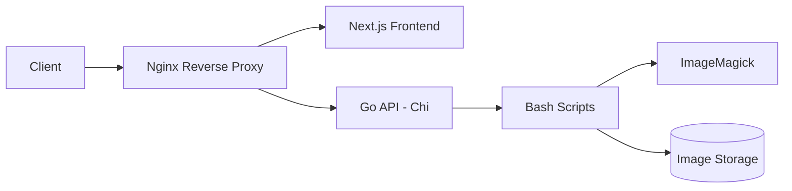

# Image Server

## Introduction

This project converted manual image and video processing into a fully automated flow — optimizing speed and efficiency, which allowed for smoother operation by removing all unnecessary and time-consuming steps.

The system was built and tied together using the following stack:

- **Frontend:** Next.js — only used for client side rendering
- **Backend:** Golang (Chi) — the API/server layer
- **Scripting:** Bash — handling image/video extraction, conversion, and manipulation
- **CLI Tools:** ImageMagick, ffmpeg
- **Containerization:** Docker/Docker Compose
- **Reverse Proxy:** Nginx

The Golang API/server used bash scripts which handled the image folder structure, ImageMagick and ffmpeg was used to do the heavy lifting: extraction, conversion, and manipulation of uploaded photos/videos. Docker containerizes each component for consistent, reproducible deployments, while Nginx sits in front as the reverse proxy to route traffic.

> **Note:** This project was created over a week and used through out my time at the company. Any further development/bug fixes was stopped after I left the company.  

## Architecture



## Getting Started

### Prerequisites

- Docker
- Docker Compose

### Run

```bash
docker-compose up -d
```

The website will be available at `http://localhost:3000` 

## Project Structure

```
.
├── frontend/        # Next.js frontend
├── backend/         # Golang (Chi) API/server
│   └── scripts/     # Bash scripts for extraction, conversion, manipulation
├── nginx/           # Nginx reverse proxy config
├── docker-compose.yml
└── Dockerfile
```


## Images


