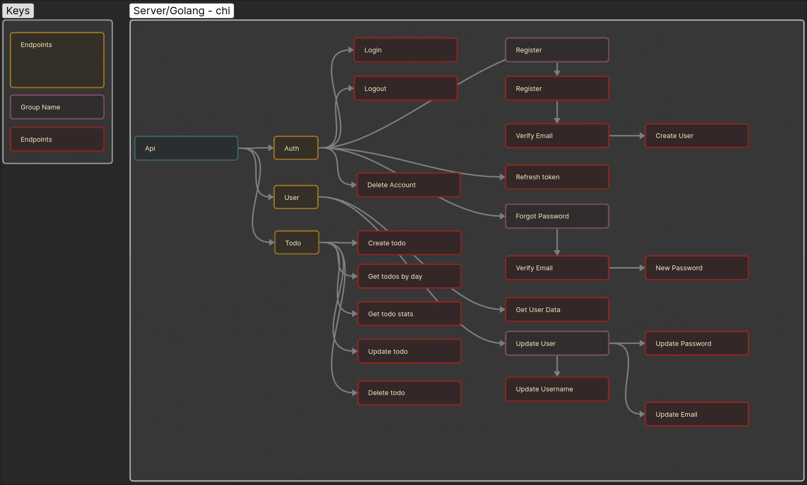

# Todo Application (Flutter/Chi/AWS RDS/AWS EC2 Instance)

A full-stack todo application built as a **7-day interview project** for a company I was previously employed at. The stack consists of a **Dart (Flutter)**, **Go (Chi)**, **Postgres (AWS RDS)**, **Open Telemetry** hosted on an **AWS EC2 instance**.

While the core CRUD functionality is straightforward, the majority of the work went into production-grade infrastructure and platform work: an email handler for verification and recovery flows, authentication (JWT), telemetry (OpenTelemetry + Grafana) for observability, deep linking, and containerization with Docker/Docker Container with reverse proxy.

## Table of Contents

- [Frontend](#frontend)
  - [Introduction](#introduction-1)
  - [Features](#features-1)
  - [Packages](#packages-1)
  - [Requirements](#requirements-1)
  - [Folder Structure](#folder-structure-1)
  - [How to Build](#how-to-build-1)
- [Backend](#backend)
  - [Introduction](#introduction-2)
  - [Features](#features-2)
  - [Packages](#packages-2)
  - [Requirements](#requirements-2)
  - [Folder Structure](#folder-structure-2)
  - [How to Build](#how-to-build-2)

---

## Frontend


### Introduction

For the frontend [Flutter](https://flutter.dev/) was the required framework using the [MVVM architecture](https://docs.flutter.dev/app-architecture/guide). Routing and deep linking are handled with `go_router`, while `provider` was used selected as the  state manager.

### Features

- User registration, login, and logout
- Password recovery 
- Deep linking via `go_router`
- Light/dark theming and localization (`intl` + ARB files)
- Persistent local storage via `shared_preferences`
- Centralized API layer with interceptors (`dio`)

### Packages

- [dio](https://pub.dev/packages/dio) — HTTP client & interceptors
- [shared_preferences](https://pub.dev/packages/shared_preferences) — local data storage
- [go_router](https://pub.dev/packages/go_router) — routing & deep linking
- [provider](https://pub.dev/packages/provider) — state management
- [json_annotation](https://pub.dev/packages/json_annotation) — model generation
- [freezed](https://pub.dev/packages/freezed) — model generation
- [intl](https://pub.dev/packages/intl) — localization

### Requirements

- [x] Mobile framework (Flutter/Dart)
- [x] Design architecture (MVVM)
- [x] Integrate backend API
- [x] State management
- [x] Routing
- [x] Documentation

### Folder Structure

```text
lib
├── config
│   └── providers.dart
├── data
│   ├── repositories
│   └── services
├── domain
│   └── models
├── l10n
│   └── app_en.arb
├── router
├── ui
│   ├── auth
│   │   ├── login
│   │   │   ├── view_model
│   │   │   └── widgets
│   │   └── logout
│   ├── core
│   │   └── theme
│   ├── home
│   ├── recover
│   │   ├── recover
│   │   └── update
│   ├── registration
│   │   ├── newuser
│   │   └── registration
│   └── settings
│       ├── nav
│       └── settings
└── utils
```

### How to Build

<details>
<summary>Prerequisites</summary>

- [Flutter](https://flutter.dev/)
- [Android Studio](https://developer.android.com/)
- SDK version: 35
- NDK version: 27.0.12077973
- Gradle version: 8.10.2

</details>

<details>
<summary>Setup</summary>

```bash
git clone "repo-url"
cd "folder"
flutter run
```

</details>

---

## Backend

### Introduction

For the backend I chose [Go](https://go.dev/) with the [Chi framework](https://go-chi.io/). The server connects to a [Postgres](https://www.postgresql.org/) database using AWS RDS, and all logs and traces are shipped to a [Grafana](https://grafana.com/) instance for observability.

The server is packaged with [Docker](https://docs.docker.com/) and [Docker Compose](https://docs.docker.com/reference/compose-file/), and a [Caddy](https://caddyserver.com/) reverse proxy which routes all traffic to port `:80`. If needed it can be horizontally scaled using [Docker Swarm](https://docs.docker.com/engine/swarm/).

### Overview



### Features

-  Reverse proxy
-  Authentication middleware (JWT)
-  Rate limiter
-  Graceful shutdown
-  Global logging
-  Mailer (email handler)
-  OpenTelemetry

### Packages

- [chi](https://go-chi.io/) — router
- [cors](https://github.com/go-chi/cors) — CORS middleware
- [httprate](https://github.com/go-chi/httprate) — rate limiting
- [uuid](https://pkg.go.dev/github.com/google/uuid) — ID generation
- [jwt](https://github.com/golang-jwt/jwt) — authentication
- [pgx](https://github.com/jackc/pgx) — Postgres driver
- [godotenv](https://github.com/joho/godotenv) — environment config
- [otel](https://opentelemetry.io/docs/languages/go/) — telemetry
- [gomail](https://github.com/go-gomail/gomail) — email handling
- crypto — hashing & utilities

### Requirements

#### Backend

- [x] CRUD
- [x] Authentication
- [x] Deploy to cloud (AWS EC2)
- [x] Integrate non-local database (AWS RDS)
- [x] Built to scale (Docker)
- [x] Documentation

#### Server

- [x] AWS EC2 instance

#### Database

- [x] AWS RDS (Postgres 17)

### Endpoints

To view and test endpoint, import [Todo server endpoints](https://github.com/crypticraccoon/nimble/blob/main/docs/Server.postman_collection.json) to postman.
### Folder Structure

```text
server/
├── conf
│   └── Caddyfile File
├── database
|	│   
│   └── scripts
│       └── Init scripts 
|     
├── docker-compose.yml
└── todo
    ├── Dockerfile                    - Server build file
    ├── internal                      - Entrance to server
	└── makefile                      - Make script to repetative cmds
       ├── api                        - Endpoints/Api 
       ├── cmd                        - App entrypoint
       ├── confs                      - Config files for all services 
       ├── database                   - Database functions
       ├── errors                     - Custom errors
       ├── logging                    - Global logger 
       ├── mailer                     - Mailer used to send emails
       ├── middlewares                - API Middleware
       ├── models                     - Models
       ├── otel                       - OTEL entrypoint
       ├── response                   - Custom server response templates
       ├── server                     - Server entrypoint
       └── utils                      - Miscellaneous functions
```


### How to Build

<details>
<summary>Prerequisites</summary>

- Git
- Docker

```bash
apt-get update
apt-get install git
```

</details>

<details>
<summary>Setup</summary>

```bash
git clone "repo-url"
cd "folder"
cp .example .env
docker compose up
```

</details>